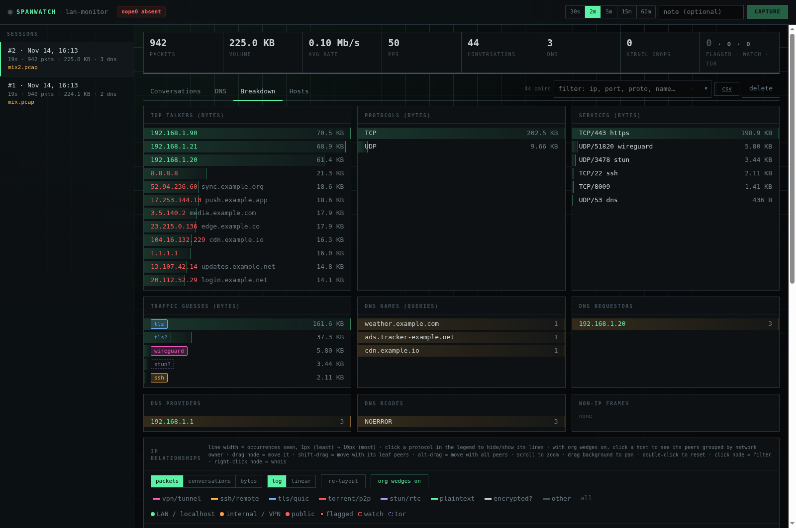

# spanwatch



Passive LAN traffic summarizer for a switch **SPAN / mirror port**. It runs short,
bounded capture sessions on a dedicated, address-less sniff NIC and summarizes them
in a small local dashboard:

- **Conversations**: client → server, protocol, *service* port (ephemeral client
  ports are folded away), packets and bytes in both directions. Server IPs are
  labelled with names learned from DNS answers in the same session (passive DNS).
- **DNS log**: one line per query: `requestor → provider  TYPE name = answers  (rcode, ms)`.
  Unanswered queries are logged as `NO-RESPONSE`.
- **Breakdown**: top talkers, protocols, services, traffic guesses, DNS names,
  requestors, providers, rcodes, and non-IP frames (ARP, LLDP, …).
- **IP relationship graph** (under Breakdown): an undirected force layout of IP pairs.
  Line width runs from 1px (seen least) to 10px (seen most). Choose packets,
  conversations, or bytes, on a log or linear scale. Line colour shows the
  traffic guess, node colour shows the address class, and node size shows volume.
  Click a protocol in the legend to hide/show its lines (shift-click isolates
  just that one, **all** resets); hidden choices persist in this browser.
  Hover a node to highlight its peers, click it to filter on it, or drag it.
  Scroll to zoom around the cursor (labels for every node appear at about 1.8×),
  drag the background to pan, and double-click or press **fit** to reset.
  Line widths keep their 1–10px meaning at any zoom level. With **org wedges**
  on (see below), clicking a host lays its direct peers out by network owner.
- **Local hostnames** (Hosts tab): learned passively from DHCP, mDNS, NetBIOS, LLMNR and reverse DNS; exportable as a hosts file (see below).
- **Whois quick view**: the ⓘ next to any public IP, or right-clicking a graph node,
  opens a side panel. It shows the org, network name/handle, range/CIDR, origin
  ASN + AS name, BGP prefix, country, RIR, abuse contact, and dates, with links to
  the RDAP JSON, ARIN search, and bgp.he.net. Looked-up orgs then label talkers and
  graph nodes.
- **Traffic guesses** for encrypted/opaque flows (see below).
- **Address colours** are the same everywhere (tables, breakdown, graph):
  green for the local LAN, localhost, link-local, and multicast; orange for other
  internal space (VPN/Tailscale CGNAT 100.64/10, RFC1918 outside the LAN, IPv6
  ULA, Docker); red for public. "Local LAN" is the subnet of whichever interface
  holds the default route, detected automatically. Add more with
  `SPANWATCH_ARGS=--lan 10.20.0.0/16` (repeatable).
- **Filter box**: matches IP, port, protocol, name, or guess. ✕ (or Esc) clears it,
  ☆ saves it, and ▾ (or ↓) opens a picker of saved and recent filters. Clicking an
  IP or using whois "filter" also adds to recent. Saved and recent filters are stored
  in this browser's localStorage only.
- Export CSV, plus DNS as plain text.

There are no third-party dependencies, only Python 3 stdlib. Capture uses
`AF_PACKET` directly, so neither libpcap nor tshark is needed.

```
2026-10-30 12:01:02  192.168.1.50 -> 192.168.1.1  A www.example.com = CNAME edge.example.net, 93.184.216.34  (NOERROR 12ms)
```

## Traffic guesses

Each conversation's first 8 payload packets are inspected. Every new TCP
connection in that conversation gets 5 more probes. Guesses carry a confidence:

| conf | UI | Evidence |
|---|---|---|
| 3 | filled badge | protocol signature: SSH banner, TLS ClientHello (**SNI** extracted, split hellos reassembled), QUIC long header, WireGuard handshake, OpenVPN hard-reset, BitTorrent handshake/DHT/UDP tracker, STUN, RDP, VNC, HTTP (Host extracted), ESP/AH |
| 2 | outline | structural or behavioural: TLS records mid-stream, WireGuard transport packets, unknown high-port traffic from a host already seen speaking BitTorrent |
| 1 | dashed, `?` | heuristic: well-known port, high-entropy payload (`encrypted?`), uTP-like headers, P2P fan-out (≥20 peers) or fan-in (≥10 clients) on unknown high ports |

These are guesses. Known blind spots: VPNs over TLS/443 (SSTP, OpenConnect)
look like TLS. OpenVPN with `tls-auth`/`tls-crypt` lacks a signature and falls
back to port. Encrypted BitTorrent (MSE) is only caught by behaviour. QUIC SNI
is not decrypted.

## IP reputation

Public IPs are checked against free threat feeds. The feeds are downloaded about
once a day into `/var/lib/spanwatch/feeds/` and matched **locally**, so no
observed address is sent anywhere for this.

| Highlight | Tier | Feeds |
|---|---|---|
| red block, black text | **bad**: high confidence | Spamhaus DROP v4/v6, abuse.ch Feodo Tracker (botnet C2), FireHOL level1 |
| red outline | **watch**: noisier, often scanners | Emerging Threats block list, CINS Army, blocklist.de |
| violet outline | **tor**: informational | Tor exit list |

- The highlight shows wherever an IP appears: conversations, DNS (including answers), breakdown lists, graph labels, and the whois panel. Hover an IP to see which lists flagged it.
- The session meter shows flagged · watch · tor counts. Click it, or type `is:flagged`, to filter. `is:bad`, `is:watch`, `is:tor`, and `is:any` also work, and they apply to CSV/txt exports too. The flows CSV gets `client_rep` / `server_rep` columns.
- Bogon and private ranges in the feeds (FireHOL level1 includes 10/8 and others) are ignored, so LAN addresses are never flagged.
- If a download fails or comes back empty, the previous copy is kept. The `feeds n/8` header chip shows each list's size, age, and any error.
- Disable with `SPANWATCH_ARGS=--no-feeds`.

**AbuseIPDB (optional, on click).** Opening the whois panel for a public IP also
queries AbuseIPDB: confidence score, report count, usage type, and a link to the
report page. Results are cached 24h. A score of 75 or more marks the IP **bad**, and
25 or more marks it **watch**. The free tier allows 1,000 checks a day. To enable it:

```sh
sudo sh -c 'umask 077; printf %s "YOUR_API_KEY" > /etc/spanwatch/abuseipdb.key'
sudo systemctl restart spanwatch
```

The key file is root-only (0600). systemd hands it to the service as a credential
(`LoadCredential`), so it never appears in the environment or the unit file.

A clean result only means nobody has reported the address yet. A hit on shared
cloud space is a reason to look closer, not proof of compromise.

## Whois lookups (outbound traffic)

These are the only thing spanwatch sends off the box, and only when you click.

- Public IPs only. RFC1918, CGNAT/Tailscale, link-local, multicast, and
  documentation ranges are refused server-side and never sent anywhere.
- RDAP goes to `rdap.arin.net`, which redirects to RIPE/APNIC/LACNIC/AFRINIC
  for their space. Origin ASN comes from Team Cymru (`whois.cymru.com:43`).
- Results are cached in SQLite for 7 days and failures for 5 minutes. Queries are
  paced at 1/s, at most 2 run at once, and duplicate concurrent requests are merged.
- The endpoint requires the `X-Spanwatch-Action` header, so other sites can't
  trigger lookups through your browser.
- Lookups leave through the normal uplink; `span0` has no address and drops all
  egress. To disable them entirely: `SPANWATCH_ARGS=--no-whois`.
- RDAP shows who *holds the address block*, and that can differ from who runs
  the service. 1.1.1.1, for example, is registered to APNIC Research and
  Development but announced by Cloudflare (AS13335). The panel shows both.

## Local hostnames (Hosts tab)

Learned passively from chatter that LAN devices broadcast about themselves. No
router credentials, no queries, nothing transmitted:

| source | what it reads | weight |
|---|---|---|
| `dhcp` | option 12 (hostname) / 81 (client FQDN) from DISCOVER/REQUEST/INFORM; ACKs and renewals bind MAC → leased IP | strong |
| `mdns` | A/AAAA and reverse-PTR records for `*.local` in multicast DNS responses | strong |
| `netbios` | NBNS name registration/refresh broadcasts (workstation names only, groups like WORKGROUP skipped) | strong |
| `dns-ptr` | reverse lookups of private addresses answered by your resolver | strong |
| `llmnr` | LLMNR responses | weak |
| `arp` | sender MAC/IP (binding only, no names) | — |
| `file` | `/etc/spanwatch/hosts` overrides in hosts-file format; always wins, re-read on change | override |

Names attach to addresses directly or through MAC→IP bindings, so a DHCP
DISCOVER that carries only a MAC still lands on the right IP once that MAC is
seen in an ARP or ACK. When an address changes hands, the newest MAC wins.
Observations accumulate across sessions in SQLite. Anything not seen for 30 days
is ignored, and anything older than 90 days is pruned. Confidence: **confirmed** means 2+ sources
agree or an override exists, **likely** means one strong source, **weak** means LLMNR only.

Learned names show in green under IPs in Conversations, DNS, top talkers, and
the graph, and the filter box matches them. Labels use *current* knowledge, so a
months-old session can show today's owner of a recycled DHCP address.

Export a hosts table:

```
curl -s 'http://127.0.0.1:9595/api/hosts.txt?min_conf=2'   # hosts-file format, provenance in comments
curl -s http://127.0.0.1:9595/api/hosts.csv
curl -s http://127.0.0.1:9595/api/hosts                    # JSON
sudo python3 -m spanwatch hosts --data /var/lib/private/spanwatch   # offline, from /opt/spanwatch
```

Coverage depends on what the mirror carries. DHCP happens at join/renew time
(lease length), mDNS and NetBIOS are near-constant, and devices that do none of
these (some IoT) stay nameless. Pin those in the override file. DHCPv6 is not
parsed.

## Inside/outside correlation (one capture, both sides of a NAT hop)

If your SPAN setup mirrors a device's LAN-side traffic *and* the router's
WAN-side traffic onto the same capture (as described in the two-SPAN wiring
above), every internet conversation shows up twice: once with the device's
real address, once with the router's public/WAN address after NAT rewrites
the source. `--wan-ip` (repeatable) tells spanwatch which address that is,
so it can join the two legs back into one:

```bash
# in /etc/spanwatch/spanwatch.env
SPANWATCH_ARGS=--pihole-url http://172.30.250.2 --wan-ip 172.16.1.7
```

**Conversations tab:** a matched inside flow gets a small badge (`✓ 98%`, or
`≈ 91% (2 tied)` when more than one device could explain the same outside
flow equally well). Click it to expand a nested row showing the outside leg
— same destination/port, confirmed from the WAN side, with its own
packet/byte counts. The matching outside flow is removed from the top-level
list so it isn't double-counted. Filter with `side:inside` / `side:outside`.
Matching is by destination+port+protocol, overlapping time, and how closely
packet/byte counts line up (NAT doesn't touch payload, so these usually
match within a percent or two). It's a best-effort join, not ground truth —
ties are shown, not guessed.

**DNS tab:** weaker and sparser. An inside query (device → your resolver)
and the resolver's own outside upstream lookup (router WAN → 9.9.9.9 /
Quad9 / OpenDNS / etc) are two different conversations, one hop apart,
linked only by asking the same question moments later — and only on a
cache miss, so most queries never show a match at all. When one does,
it nests the same way, with the delay between the two.

Flows or DNS rows where neither address is yours (or both are) get no side
at all — ordinary LAN-to-LAN traffic and the outside leg's own unrelated
destinations are left alone.

## Org wedges (graph)

With **org wedges on** (button next to re-layout, on by default), clicking a
host in the IP graph lays out that host's direct peers around it in slices by
network owner: Amazon 12–3 o'clock, Google 3–6, Microsoft 6–9, everyone else
9–12. LAN peers go in the "others" slice. Click the host again to return to
the normal layout. Each slice shows a count, and public nodes get a ring in
their group colour.

Ownership comes from a local copy of the free [iptoasn.com](https://iptoasn.com)
table (~11 MB, downloaded daily to `<data>/feeds/`, ~80 MB RAM once loaded),
so no addresses leave the box. Every public node also gets its network owner
as a label and tooltip line (`network: AS16509 Amazon.com, Inc. (US)`), even
outside wedge mode. It reports **whose network** an address is on, not whose
service it is: SaaS on AWS or Google Cloud lands in Amazon's or Google's slice.

To change the groups, write `/etc/spanwatch/orgs.json` (or pass
`--orgs-file`). Slices are equal and run clockwise from 12 o'clock in list
order. `match` is a case-insensitive regex tried against the AS description
when the ASN isn't listed. A catch-all `other` group is added when missing:

```json
[
  {"id": "amazon", "name": "Amazon", "asns": [16509, 14618], "match": "\\bamazon\\b", "color": "#ff9f43"},
  {"id": "google", "name": "Google", "asns": [15169, 396982], "match": "\\bgoogle\\b", "color": "#6cb6ff"},
  {"id": "apple", "name": "Apple", "asns": [714, 6185], "color": "#c9d4d8"},
  {"id": "other", "name": "Others"}
]
```

`--no-asn` turns off the download.

## Pi-hole (optional, outbound)

If Pi-hole v6 runs your DHCP/DNS, spanwatch can read it instead of guessing:

- **DHCP leases** become a `pihole-dhcp` hostname source. The DHCP server's
  own lease table is authoritative, so these names are `confirmed` (conf 3).
- **FTL's network table** becomes a `pihole` source (MAC → IPs with names),
  and the Hosts tab shows the MAC vendor under each address.
- **Blocked queries**: the DNS log marks lookups Pi-hole blocked (status such
  as `GRAVITY` or `REGEX`), struck through with a red `blocked` badge.
  Filter with `is:blocked`. Matching is by client IP + domain within the
  time window Pi-hole saw it blocked. Pairs unseen for 30 days are dropped.

Every `--pihole-interval` seconds (default 300) it logs in, makes GET
requests only, and logs out, so no API session slot stays occupied. The
first poll backfills a day of queries.

Pi-hole v6 has **no read-only API scope**: an app password is a full admin
credential. Keep it root-only. systemd hands it to the DynamicUser with
`LoadCredential`, the same way as the AbuseIPDB key. It is never logged or
returned by the dashboard.

```bash
# Pi-hole web UI: Settings → Web interface / API → Expert → Configure app password
sudo sh -c 'umask 077; cat > /etc/spanwatch/pihole.key'      # paste, Enter, Ctrl-D
# add to SPANWATCH_ARGS in /etc/spanwatch/spanwatch.env:
#   --pihole-url http://172.30.250.2
sudo deploy/install.sh update
```

The dashboard header shows a `pihole` chip (lease count, or the error on
hover). With a macvlan Pi-hole, point `--pihole-url` at an address the host
can reach (a bridge network). The host can't reach its own macvlan children.

## Receive-only by design

The sniff port must never take part in the network. That is enforced in layers:

| Layer | What | Kind |
|---|---|---|
| udev guard | USB Ethernet NICs get `NM_UNMANAGED=1`, so NetworkManager never DHCPs them on plug-in | policy |
| udev pin | the adapter's MAC is pinned to the name `span0`, which is unmanaged | policy |
| sysctl | `disable_ipv6=1`, `accept_ra=0`, `autoconf=0`: no link-local, no SLAAC | kernel |
| link | `arp off`, `multicast off`, addresses flushed | kernel |
| **nftables netdev egress hook** | `policy drop` on every frame transmitted on `span0` | **hard** |
| app | capture refuses to start if the interface has any IPv4/IPv6 address | check |
| dashboard | chips for `no IP ✓`, promisc, and `tx` packet counter (should stay 0) | visibility |

## Privilege model

- `spanwatch.service` runs as a systemd **DynamicUser** that holds only
  `CAP_NET_RAW`. It also gets `ProtectSystem=strict`, `ProtectHome`, a syscall
  filter, and restricted address families.
- The code it runs is a **root-owned copy in `/opt/spanwatch`**. A capability-holding
  service never executes user-writable files.
- `spanwatch-iface@span0.service` (root, oneshot) does the link setup. It is tied to the
  device unit, so it runs again on every hotplug.
- The dashboard listens on `127.0.0.1:9595` only. It checks the Host header (DNS-rebinding
  guard), and mutating calls need an `X-Spanwatch-Action` header (CSRF guard).
- Data lives in `/var/lib/spanwatch` (SQLite). By default the newest 50 sessions are kept.

## Install

```sh
git clone https://github.com/gunnoej5/spanwatch && cd spanwatch
python3 -m unittest            # no root needed
sudo deploy/install.sh install # BEFORE plugging the adapter in
# plug the 2.5G adapter into this host and the SPAN port
ip -br link                    # find it, e.g. enx00e04c68xxxx
sudo deploy/install.sh pin enx00e04c68xxxx
```

Then open http://127.0.0.1:9595, pick a duration (30s to 60m), and click **Capture**.

To ship code changes: `sudo deploy/install.sh update`. To remove everything:
`sudo deploy/install.sh uninstall`, which keeps the data.

Options live in `/etc/spanwatch/spanwatch.env`, for example
`SPANWATCH_ARGS=--dns-ports 53,5353,5355 --keep 100`. `--hostname NAME`
overrides what the dashboard header shows instead of the real system hostname
(handy if you don't want a device nickname in a screenshot).

### Offline / dev

```sh
python3 -m spanwatch import some.pcap --data ./data   # classic pcap, Ethernet or Linux SLL
python3 -m spanwatch serve --listen 127.0.0.1:9596 --data ./data
python3 -m spanwatch status --iface span0             # exit 0 iff present and address-less
```

## Limits and caveats

- **DNS visibility.** Only plaintext DNS on the configured ports (default 53) is
  visible. DoH (443) and DoT (853) show up only as conversations; DoT is labelled
  `dns-over-tls`. DNS over TCP is parsed best-effort, one message per segment.
- **Throughput.** Python parse+aggregate benchmarks at about 730k pps on one core. That
  is well above 2.5G line rate for full-size frames (about 206k pps), but small-packet
  floods can exceed it. Kernel drops appear in the meter. A TPACKET_V3 mmap ring
  would be the next step up.
- **What gets mirrored.** The SPAN config decides what you see. If you mirror
  both directions of the uplink, every packet is seen once. If you mirror several access
  ports, packets between them are counted twice.
- **Fragments.** Non-first IP fragments carry no ports, so they show as a portless row.
- Session memory is capped at 250k conversations and 100k DNS records.

## License

[MIT](LICENSE)
